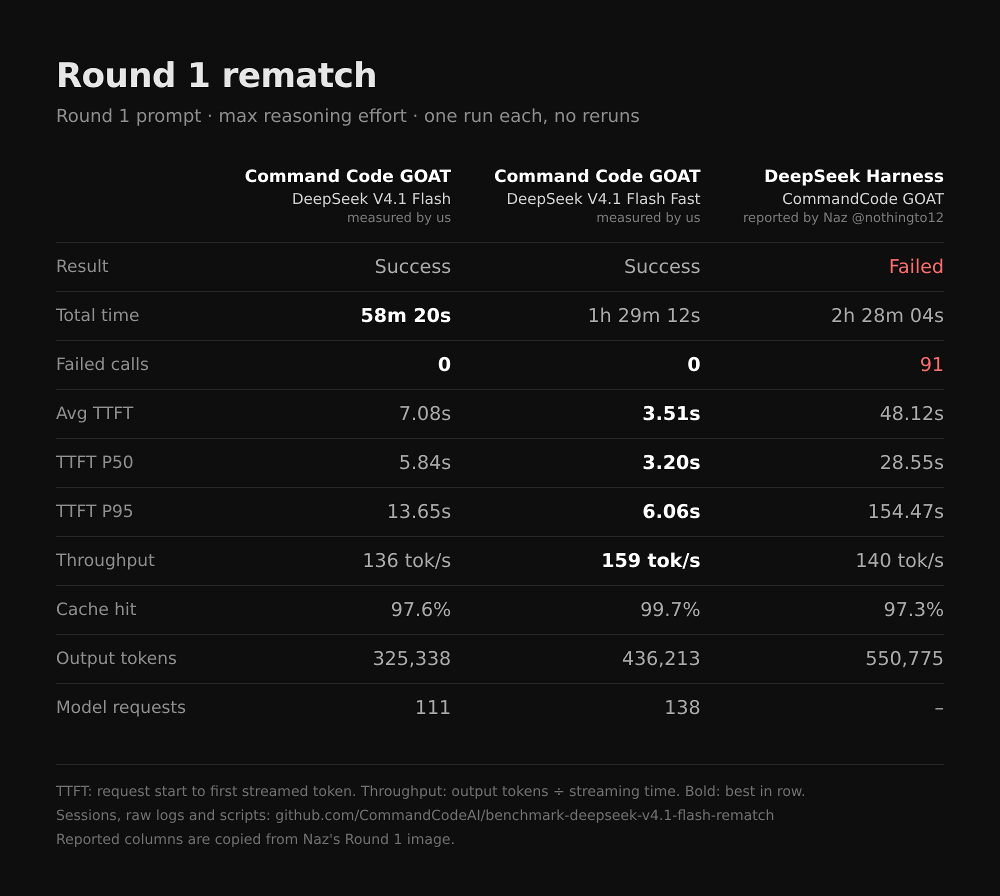
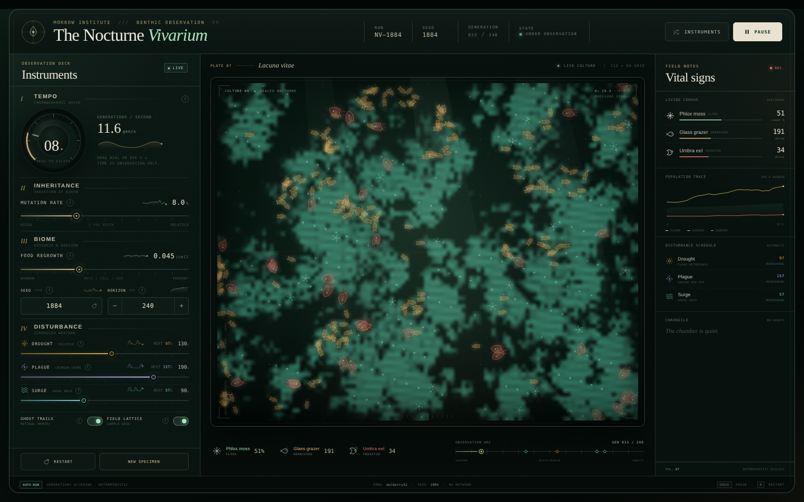
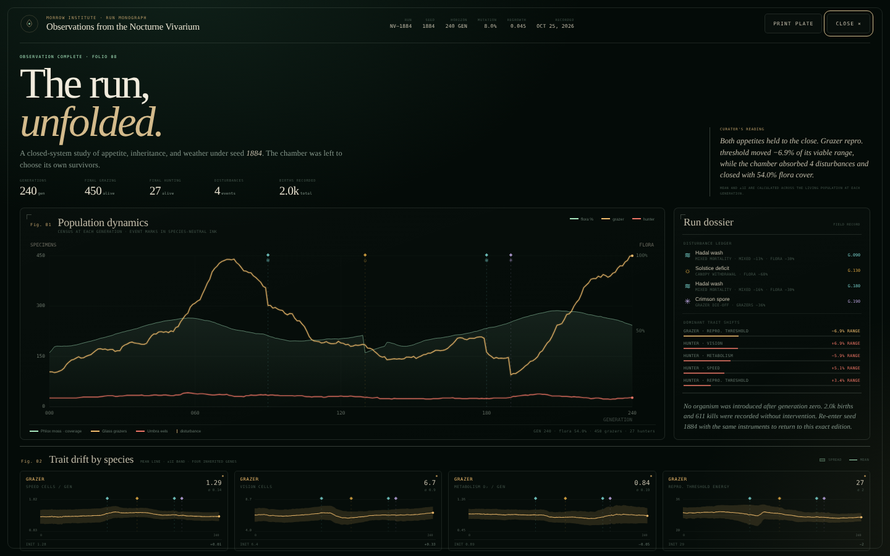
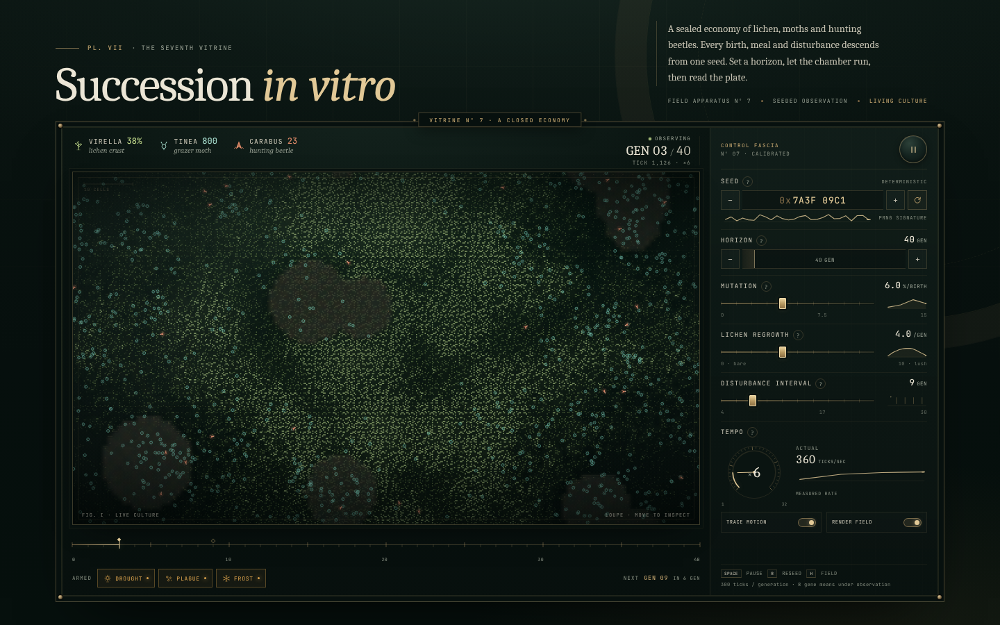
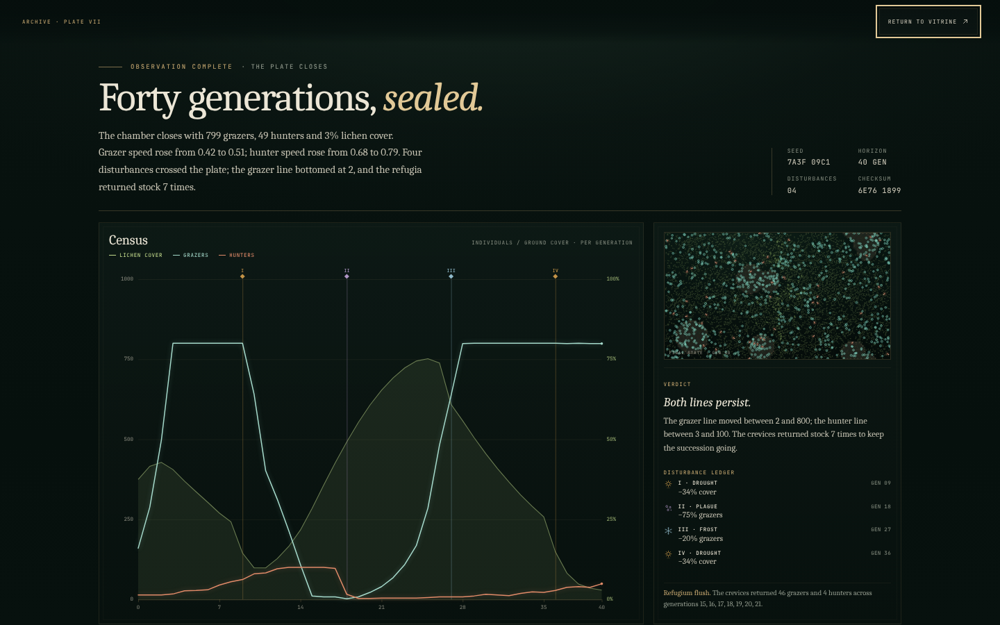

# benchmark-deepseek-v4.1-flash-rematch

Round 1 rematch: Command Code × DeepSeek V4.1 Flash.

**Play both games:** [commandcodeai.github.io/benchmark-deepseek-v4.1-flash-rematch](https://commandcodeai.github.io/benchmark-deepseek-v4.1-flash-rematch/)
· [The Nocturne Vivarium (V4.1 Flash)](https://commandcodeai.github.io/benchmark-deepseek-v4.1-flash-rematch/runs/deepseek-v4.1-flash/output/index.html)
· [Succession in vitro (V4.1 Flash Fast)](https://commandcodeai.github.io/benchmark-deepseek-v4.1-flash-rematch/runs/deepseek-v4.1-flash-fast/output/index.html)

**Our runs are fully open source.** This repo has both full Command Code session
files, the raw timestamped event logs, every file the models wrote, and the
scripts behind every number. Anyone can check them and recompute the results.

**Naz's runs are unverified.** His
["Round 1 - DeepSeek API vs OpenCode Go vs CommandCode GOAT"](https://x.com/nothingto12/status/2114460558758236351)
post ([image](./original-post-claim.webp), [demos](https://nazzysar.github.io/deepseek-benchmarks/))
reports a failed CommandCode GOAT run through the DeepSeek Harness (DSH): 2h 28m 04s,
48.12s average TTFT, 154.47s P95 TTFT and 91 failed calls. It publishes no
session files or logs, so with no transparency there is no way to see why things
went wrong. It could be his network, a VPN, or the third-party DeepSeek Harness.
Command Code serves a standard API, and our harness recursively self-improves on
every model we serve, which is why these runs held up.

We ran the **same prompt** ([`prompt.txt`](./prompt.txt)) at the **same reasoning
effort (max)** through the **Command Code harness** on DeepSeek V4.1 Flash and
V4.1 Flash Fast. Both succeeded with **0 failed calls** across 249 requests.



Also: [`round1-two-runs.png`](./round1-two-runs.png) (just the two Command Code
GOAT runs) and [`round1-all-five.png`](./round1-all-five.png) (Naz's three
DeepSeek Harness runs next to ours).

## Results

| | Command Code GOAT · V4.1 Flash | Command Code GOAT · V4.1 Flash Fast | DeepSeek Harness · CommandCode GOAT (Naz @nothingto12, as reported) |
|---|---|---|---|
| Result | ✓ Successful run | ✓ Successful run | ✕ Failed run |
| Total time | 58m 20s | 1h 29m 12s | 2h 28m 04s |
| Throughput | 136 tok/s | 159 tok/s | 140 tok/s |
| Avg TTFT | 7.08s | 3.51s | 48.12s |
| TTFT P50 | 5.84s | 3.20s | 28.55s |
| TTFT P95 | 13.65s | 6.06s | 154.47s |
| Cache hit | 97.6% | 99.7% | 97.3% |
| Uncached input | 710,281 tok | 125,091 tok | 1,820,736 tok |
| Cached input | 29,067,264 tok | 46,199,168 tok | 65,634,432 tok |
| Output | 325,338 tok | 436,213 tok | 550,775 tok |
| Model requests | 111 | 138 | n/a |
| Failed API calls | **0** | **0** | 91 |
| Tool errors (model-side) | 1 | 2 | n/a |

Both runs exited `0` with `"subtype":"success"`, one attempt each, no reruns.
Both generated pages auto-start, run to the end and switch into the dashboard
with zero console errors and zero network requests (see `screenshots/`).

## The games they built

Both runs auto-start, simulate on their own, and switch into the post-run dashboard.
Screenshots are from our headless check, at 3s (live) and 120s (run complete).
Compare with Naz's demos at [nazzysar.github.io/deepseek-benchmarks](https://nazzysar.github.io/deepseek-benchmarks/).

### Command Code GOAT · DeepSeek V4.1 Flash: "The Nocturne Vivarium"

| Live simulation | End-of-run dashboard |
|---|---|
| [](https://commandcodeai.github.io/benchmark-deepseek-v4.1-flash-rematch/runs/deepseek-v4.1-flash/output/index.html) | [](https://commandcodeai.github.io/benchmark-deepseek-v4.1-flash-rematch/runs/deepseek-v4.1-flash/output/index.html) |

### Command Code GOAT · DeepSeek V4.1 Flash Fast: "Succession in vitro"

| Live simulation | End-of-run dashboard |
|---|---|
| [](https://commandcodeai.github.io/benchmark-deepseek-v4.1-flash-rematch/runs/deepseek-v4.1-flash-fast/output/index.html) | [](https://commandcodeai.github.io/benchmark-deepseek-v4.1-flash-rematch/runs/deepseek-v4.1-flash-fast/output/index.html) |

**▶ Play them live:** [The Nocturne Vivarium](https://commandcodeai.github.io/benchmark-deepseek-v4.1-flash-rematch/runs/deepseek-v4.1-flash/output/index.html) · [Succession in vitro](https://commandcodeai.github.io/benchmark-deepseek-v4.1-flash-rematch/runs/deepseek-v4.1-flash-fast/output/index.html) · [both, side by side](https://commandcodeai.github.io/benchmark-deepseek-v4.1-flash-rematch/)

Or clone the repo and open [`runs/deepseek-v4.1-flash/output/index.html`](./runs/deepseek-v4.1-flash/output/index.html)
or [`runs/deepseek-v4.1-flash-fast/output/index.html`](./runs/deepseek-v4.1-flash-fast/output/index.html)
in a browser (on github.com those two links show the source). No server, no network needed.

## What this shows

Over 249 model requests across two runs, the Command Code service returned
**zero** failed calls, zero timeouts and zero transport errors on this exact
prompt. Average TTFT was 7.08s and 3.51s, against the 48.12s the post reports,
and P95 TTFT was 13.65s and 6.06s, against 154.47s.

The post ran through the DSH harness over the author's own network, and those are
the parts of the path that differ from ours. Its 34 transport failures are
connections that broke between the client and the service, which points at that
network or the harness's HTTP handling. Its 57 server errors are responses that
came back, which can be caused by how a harness builds requests, or by the
service at that moment; without that run's logs nobody can tell which. If the
author publishes their raw logs, we will go through them.

## Setup

- CLI: `command-code@1.88.0` from npm, authenticated with a Command Code API key
  (normal Command Code backend, no BYOK, no local-only mode).
- Models: `deepseek/deepseek-v4.1-flash` and `deepseek/deepseek-v4.1-flash-fast`.
- Command (see each `runs/*/run.sh`):

  ```
  cmd -p "<prompt>" -m deepseek/<model> --effort max --output-format json \
    --yolo --trust --skip-onboarding --no-auto-update --max-turns 400
  ```

- Each run started in an empty git repo. Both runs ran at the same time on the
  same machine, 2026-10-25, starting 21:28 UTC.
- `-p` is headless mode, so the default headless tool set applied (`--tools-all`
  was not passed). `--max-turns 400` only lifts the default cap of 100, neither
  run came near it.

## How each number is computed

[`scripts/ts.mjs`](./scripts/ts.mjs) reads the CLI's NDJSON stdout and stamps each
line with its arrival time. It never talks to the model or the harness.
[`scripts/analyze.mjs`](./scripts/analyze.mjs) turns that log into `metrics.json`:

- **Total time**: wall clock from launch to exit (`start`, `end`).
- **TTFT**: `model_request_start` → first streamed delta of that request.
- **Throughput**: total output tokens ÷ total streaming time (first delta →
  `model_request_end`), summed over requests.
- **Cache hit**: `cacheReadTokens ÷ inputTokens`. Uncached input is
  `inputTokens − cacheReadTokens − cacheWriteTokens`.
- **Failed API calls**: a `model_request_start` with no matching
  `model_request_end`, plus any error, retry or failure event that is not a tool
  event. Both runs: 0.
- **Tool errors** are counted separately because they are the model's own
  mistakes, not provider failures (for example `edit_file` refused because the
  file changed since it was last read). The run continues after each one.

Reproduce:

```
cd runs/deepseek-v4.1-flash-fast
gunzip -k events.ndjson.gz && sha256sum -c events.ndjson.sha256
node ../../scripts/analyze.mjs .   # matches metrics.json byte for byte
```

## Notes we are not hiding

- Flash Fast had one slow request: 6m 24s at 28 tok/s for 10,751 tokens
  (its first token arrived quickly; the stream itself was slow). The four
  requests before it ran at 179–270 tok/s. It is included in every number above.
- Flash Fast took longer overall than plain Flash because it did more work
  (138 vs 111 requests, 436K vs 325K output tokens), not because of failures.
- This is a different setup from the post: Command Code's own CLI rather than
  the DSH harness, and V4.1 Flash rather than whatever "GOAT" routed to there.
  It shows what the Command Code stack does on this task today. It does not
  replay the post's run.
- One run per model. Repeat runs would tighten the numbers.
- Machine-specific details were normalized before publishing, and nothing else
  was changed: local paths are rewritten (the working directory reads `/work`),
  and a few names in the models' own listings of the machine's installed tools
  read `[redacted]`. Token counts and timestamps are untouched, and the metrics
  reproduce exactly from the published logs.
- The DeepSeek Harness columns (Naz's runs) are copied from his Round 1 image,
  not measured here.

## What is in this repo

Nothing from the runs was thrown away.

```
round1-*.png                results cards (scripts/card.mjs + layouts/*.json)
original-post-claim.webp    the image from the post being answered
prompt.txt                  the exact prompt
scripts/                    ts.mjs, analyze.mjs, card.mjs, shot.cjs
scripts/reported/           Naz's three DeepSeek Harness runs, copied from his image
layouts/                    which columns go in each card
runs/<model>/
  run.sh                    exact launch script
  start, end, exit          epoch ms timestamps and exit code
  stderr.txt                CLI stderr
  events.ndjson.gz          full timestamped NDJSON event stream (gzipped, lossless)
  events.ndjson.sha256      checksum of the uncompressed stream
  metrics.json              computed metrics
  session/                  Command Code session: transcript (.jsonl),
                            checkpoints (.checkpoints.jsonl), metadata (.meta.json)
  output/                   everything the model wrote in its working dir,
                            final index.html plus every intermediate file
  tmp-files/                files the model wrote to /tmp (test scripts,
                            its own screenshots), attributed via its transcript
  screenshots/              our headless checks at 3s, 30s and 120s
unattributed-tmp/           /tmp files from the run window whose names are built
                            dynamically, so neither transcript names them
                            (one, check-page.js, is named by both)
probe/                      the one-word "say hi" probe run first to check the
                            output format, plus a mid-run preview of the card
```

The empty `.git` that `git init` created in each working dir is the only thing
left out: it held no commits, and a nested `.git` cannot be committed.
