# benchmark-deepseek-v4.1-flash-rematch

Round 1 rematch: Command Code × DeepSeek V4.1 Flash.

> **Run by AI agents.** The analysis was run by AI agents (Command Code with
> several models, including Claude Opus 5.5 and DeepSeek V4.1 Flash) with little
> to no human oversight. Rerun the scripts to check it.

> **Using an API means owning your client.** When you call the Command Code
> Provider API, or any model API, from your own harness or client, you are
> responsible for what it sends. A client that resends ~90 screenshots on every
> request across 3 concurrent agents and blindly retries every failure, as
> happened in Naz's run, will struggle on any provider. Keep image payloads in
> check, cap request sizes and back off on errors.

**Play the games:** [commandcodeai.github.io/benchmark-deepseek-v4.1-flash-rematch](https://commandcodeai.github.io/benchmark-deepseek-v4.1-flash-rematch/)
· [The Nocturne Vivarium (V4.1 Flash)](https://commandcodeai.github.io/benchmark-deepseek-v4.1-flash-rematch/runs/deepseek-v4.1-flash/output/index.html)
· [Succession in vitro (V4.1 Flash Fast)](https://commandcodeai.github.io/benchmark-deepseek-v4.1-flash-rematch/runs/deepseek-v4.1-flash-fast/output/index.html)

**Our runs are fully open source.** This repo has both full Command Code session
files, the raw timestamped event logs, every file the models wrote, and the
scripts behind every number. Anyone can check them and recompute the results.

**Naz's run was not a stock benchmark.** His
["Round 1 - DeepSeek API vs OpenCode Go vs CommandCode GOAT"](https://x.com/nothingto12/status/2114460558758236351)
post ([image](./original-post-claim.webp), [demos](https://nazzysar.github.io/deepseek-benchmarks/))
reports a failed CommandCode GOAT run through the DeepSeek Harness (DSH): 2h 28m 04s,
48.12s average TTFT, 154.47s P95 TTFT and 91 failed calls. He has since published
his session files, and we put them here with a full analysis:
**[`naz-session/`](./naz-session/)**. They show image input turned on, 92
screenshots resent on every request (up to ~20 MB each), and 3 concurrent Agent
Teams agents. "2h 28m 04s" is a helper agent he stopped by hand, after the build
had already failed, and the TTFT numbers were computed by the agent itself,
retries and waits included. With no screenshots in context, his own run had 0
failures and a 3.9s P50 TTFT.

> Naz, your run wasn't a stock benchmark. It was ~90 screenshots across 3
> concurrent Agent Teams agents, with image input on. DSH resends every image on
> every turn, so each request grew toward 20 MB, times 3 agents, nonstop.
>
> On top of that, DSH:
>
> - retries a 1102 five times blindly, so one failure becomes six heavy requests
> - replays every image during compaction
> - has no image offload by default (Zayd's plugin exists for exactly this)
>
> That's where your 91 failed calls and 48s TTFT came from. The harness kept
> piling the same images on.
>
> We ran DSH ourselves on stock config with the same model and key: rc.3 had 0
> failures in 148 requests. All data is public in this repo.
>
> We're hardening the API for heavy image payloads anyway (streaming media
> upstream, 32 MB limit). Happy to rerun your exact setup side by side once it ships.

We ran the **same prompt** ([`prompt.txt`](./prompt.txt)) at the **same reasoning
effort (max)** through the **Command Code harness** on DeepSeek V4.1 Flash and
V4.1 Flash Fast. Both succeeded with **0 failed calls** across 249 requests.


Also: [`round1-two-runs.png`](./round1-two-runs.png) (just the two Command Code
GOAT runs), [`round1-all-five.png`](./round1-all-five.png) (Naz's three
DeepSeek Harness runs next to ours), and
[`round1-all-harnesses.png`](./round1-all-harnesses.png) (every harness we ran,
[below](#every-harness-same-api-key)).

## Results

| | Command Code GOAT · V4.1 Flash | Command Code GOAT · V4.1 Flash Fast | DeepSeek Harness · CommandCode GOAT (Naz @nothingto12, as reported) |
|---|---|---|---|
| Result | ✓ Successful run | ✓ Successful run | ✕ Failed run |
| Total time | 58m 20s | 1h 29m 12s | 2h 28m 04s |
| Throughput | 136 tok/s | 159 tok/s | 140 tok/s |
| Avg TTFT | 7.08s | 3.51s | 48.12s |
| TTFT P50 | 5.84s | 3.20s | 28.55s |
| TTFT P95 | 13.65s | 6.06s | 154.47s |
| Cache hit | 97.6% | 99.7% | 97.3% |
| Uncached input | 710,281 tok | 125,091 tok | 1,820,736 tok |
| Cached input | 29,067,264 tok | 46,199,168 tok | 65,634,432 tok |
| Output | 325,338 tok | 436,213 tok | 550,775 tok |
| Model requests | 111 | 138 | n/a |
| Failed API calls | **0** | **0** | 91 |
| Tool errors (model-side) | 1 | 2 | n/a |

Both runs exited `0` with `"subtype":"success"`, one attempt each, no reruns.
Both generated pages auto-start, run to the end and switch into the dashboard
with zero console errors and zero network requests (see `screenshots/`).

## Every harness, same API key

We then ran the same prompt on the same model (DeepSeek V4.1 Flash, max effort)
through the latest versions of other harnesses, all of them pointed at Command
Code's OpenAI-compatible **Provider API** (`https://api.commandcode.ai/provider/v1`)
with the same Command Code key as BYOK. Each run is in `runs/` with its own
session files, every request and response body, and the game it built.

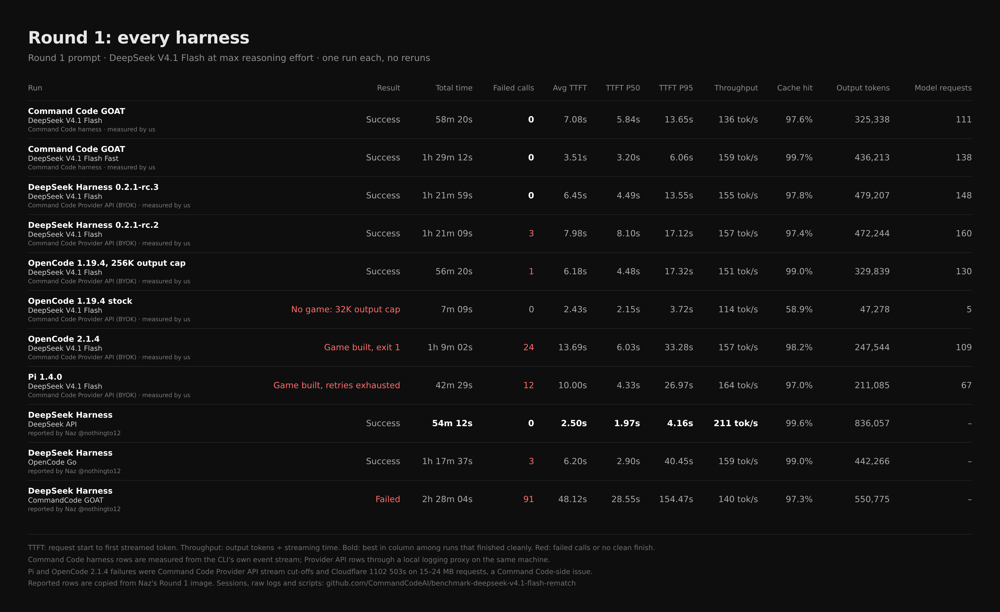

| Harness | Result | Total time | Requests | Failed calls | Avg TTFT | TTFT P50 | TTFT P95 | Throughput | Cache hit | Output |
|---|---|---|---|---|---|---|---|---|---|---|
| **Command Code harness** · V4.1 Flash | ✅ Success | 58m 20s | 111 | **0** | 7.08s | 5.84s | 13.65s | 136 tok/s | 97.6% | 325K |
| **Command Code harness** · V4.1 Flash Fast | ✅ Success | 1h 29m 12s | 138 | **0** | 3.51s | 3.20s | 6.06s | 159 tok/s | 99.7% | 436K |
| DeepSeek Harness 0.2.1-rc.3 | ✅ Success | 1h 21m 59s | 148 | 0 | 6.45s | 4.49s | 13.55s | 155 tok/s | 97.8% | 479K |
| DeepSeek Harness 0.2.1-rc.2 | ✅ Success | 1h 21m 09s | 160 | 3 (cut-off streams) | 7.98s | 8.10s | 17.12s | 157 tok/s | 97.4% | 472K |
| OpenCode 1.19.4, output cap raised to 256K | ✅ Success | 56m 20s | 130 | 1 (cut-off stream) | 6.18s | 4.48s | 17.32s | 151 tok/s | 99.0% | 330K |
| OpenCode 1.19.4 stock | ❌ No game: 32K output cap | 7m 09s | 5 | 0 | 2.43s | 2.15s | 3.72s | 114 tok/s | 58.9% | 47K |
| OpenCode 2.1.4 | ⚠️ Game built, exit 1 | 1h 09m 02s | 109 | 24 (16 cut-off, 8 × 503) | 13.69s | 6.03s | 33.28s | 157 tok/s | 98.2% | 248K |
| Pi 1.4.0 | ⚠️ Game built, retries exhausted | 42m 29s | 67 | 12 (11 cut-off, 1 × 503) | 10.00s | 4.33s | 26.97s | 164 tok/s | 97.0% | 211K |
| DeepSeek Harness · DeepSeek API (Naz, reported) | ✅ Success | 54m 12s | – | 0 | 2.50s | 1.97s | 4.16s | 211 tok/s | 99.6% | 836K |
| DeepSeek Harness · OpenCode Go (Naz, reported) | ✅ Success | 1h 17m 37s | – | 3 | 6.20s | 2.90s | 40.45s | 159 tok/s | 99.0% | 442K |
| DeepSeek Harness · CommandCode GOAT (Naz, reported) | ❌ Failed | 2h 28m 04s | – | 91 | 48.12s | 28.55s | 154.47s | 140 tok/s | 97.3% | 551K |

What these runs show, plainly:

- **The Command Code harness is the only one with zero failed calls on both
  models.** OpenCode 1.19.4 with its output cap raised finished 2 minutes
  faster than plain Flash on the Command Code harness, with one recoverable
  cut-off stream.
- **The DeepSeek Harness works through Command Code.** DSH 0.2.1-rc.3 (the
  version Naz says he used) finished with 0 failed calls in 148 requests and a
  13.55s P95 TTFT. His 91 failures and 48s average TTFT did not reproduce here.
- **Stock OpenCode 1.19.4 caps every request at 32,000 output tokens**,
  whatever the model allows. At max effort the model spent all of them
  reasoning, the response was cut for length, and OpenCode ended the run with
  no file written. The 256K row raises the cap with OpenCode's own
  `OPENCODE_EXPERIMENTAL_OUTPUT_TOKEN_MAX`.
- **Pi and OpenCode 2.1.4 read their own screenshots back into context**, so
  each request carried 15–24 MB of images, and some of those requests failed.
  The harness should keep image payloads in check, but when it doesn't, the
  Provider API will stream the images upstream instead of failing. That
  improvement is in progress.

## The games they built

Both runs auto-start, simulate on their own, and switch into the post-run dashboard.
Screenshots are from our headless check, at 3s (live) and 120s (run complete).
Compare with Naz's demos at [nazzysar.github.io/deepseek-benchmarks](https://nazzysar.github.io/deepseek-benchmarks/).

### Command Code GOAT · DeepSeek V4.1 Flash: "The Nocturne Vivarium"

| Live simulation | End-of-run dashboard |
|---|---|
| [](https://commandcodeai.github.io/benchmark-deepseek-v4.1-flash-rematch/runs/deepseek-v4.1-flash/output/index.html) | [](https://commandcodeai.github.io/benchmark-deepseek-v4.1-flash-rematch/runs/deepseek-v4.1-flash/output/index.html) |

### Command Code GOAT · DeepSeek V4.1 Flash Fast: "Succession in vitro"

| Live simulation | End-of-run dashboard |
|---|---|
| [](https://commandcodeai.github.io/benchmark-deepseek-v4.1-flash-rematch/runs/deepseek-v4.1-flash-fast/output/index.html) | [](https://commandcodeai.github.io/benchmark-deepseek-v4.1-flash-rematch/runs/deepseek-v4.1-flash-fast/output/index.html) |

### Other harnesses, same model, through the Command Code Provider API

Stock OpenCode 1.19.4 built nothing, so it has no game.

#### DeepSeek Harness 0.2.1-rc.3: "The Quiet Vivarium"

| Live simulation | End-of-run dashboard |
|---|---|
| [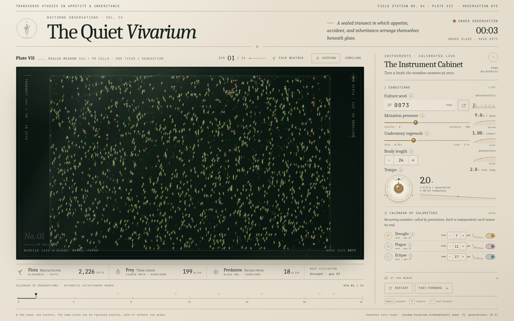](https://commandcodeai.github.io/benchmark-deepseek-v4.1-flash-rematch/runs/dsh-0.2.1-rc.3/output/index.html) | [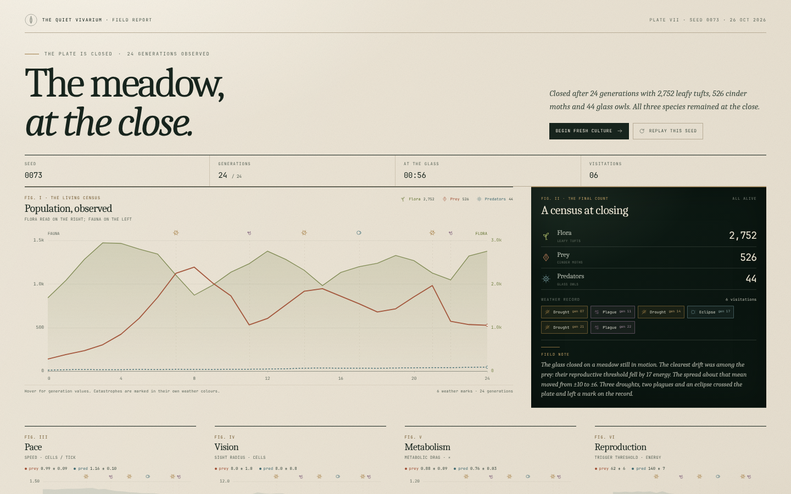](https://commandcodeai.github.io/benchmark-deepseek-v4.1-flash-rematch/runs/dsh-0.2.1-rc.3/output/index.html) |

#### DeepSeek Harness 0.2.1-rc.2: "The Glass Garden"

| Live simulation | End-of-run dashboard |
|---|---|
| [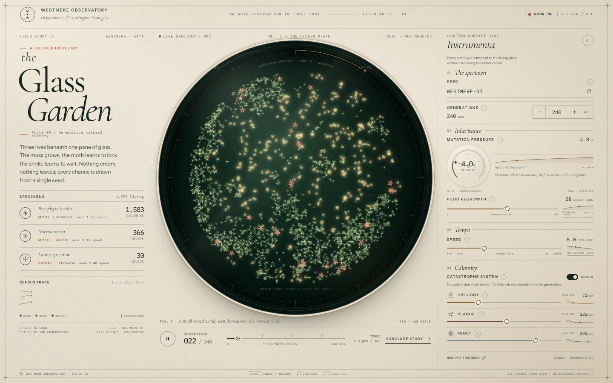](https://commandcodeai.github.io/benchmark-deepseek-v4.1-flash-rematch/runs/dsh-0.2.1-rc.2/output/index.html) | [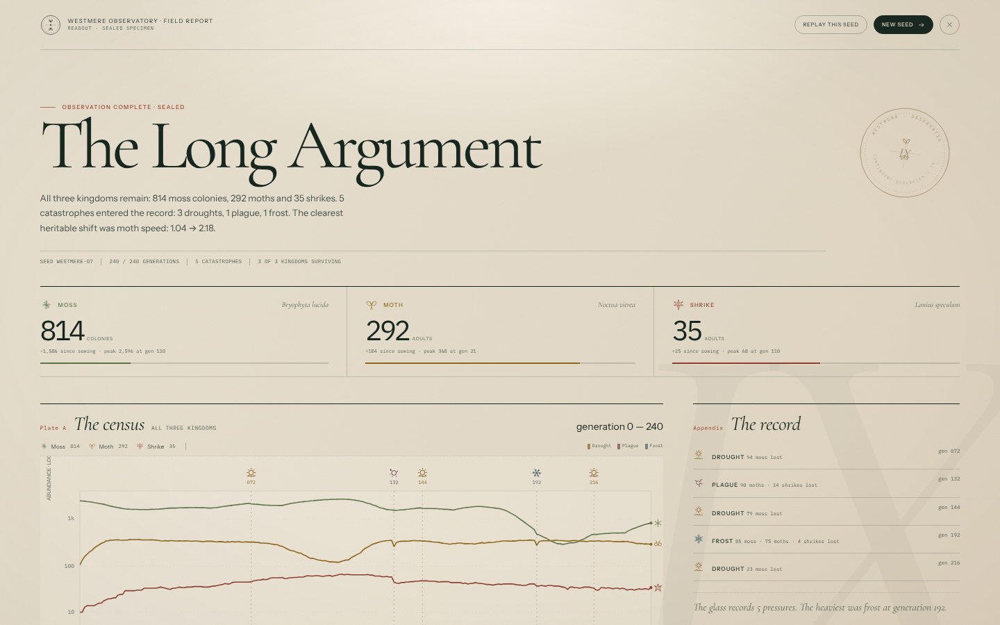](https://commandcodeai.github.io/benchmark-deepseek-v4.1-flash-rematch/runs/dsh-0.2.1-rc.2/output/index.html) |

#### OpenCode 1.19.4 (256K cap): "The Vivarium"

| Live simulation | End-of-run dashboard |
|---|---|
| [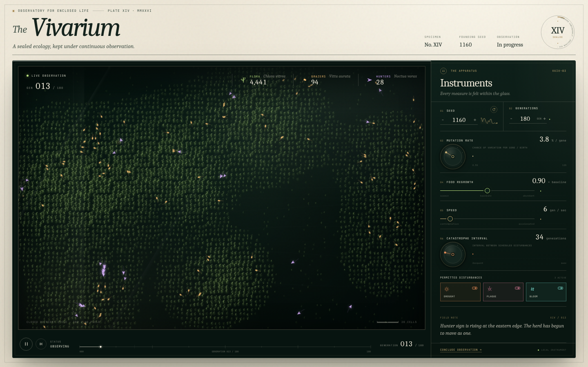](https://commandcodeai.github.io/benchmark-deepseek-v4.1-flash-rematch/runs/opencode-1.19.4-256k/output/index.html) | [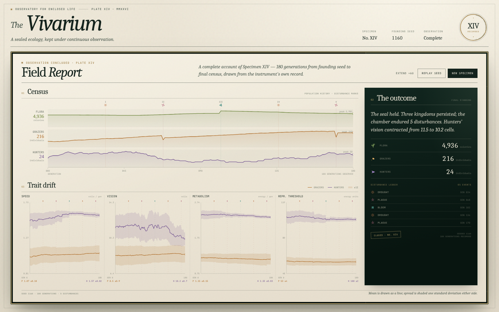](https://commandcodeai.github.io/benchmark-deepseek-v4.1-flash-rematch/runs/opencode-1.19.4-256k/output/index.html) |

#### OpenCode 2.1.4: "Glasshouse Ledger"

| Live simulation | End-of-run dashboard |
|---|---|
| [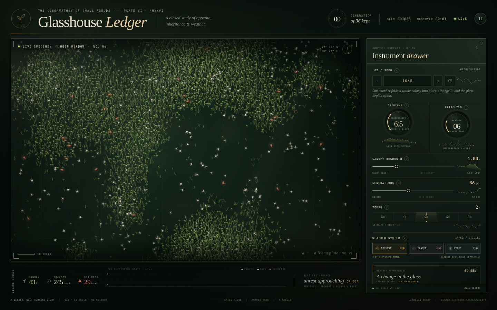](https://commandcodeai.github.io/benchmark-deepseek-v4.1-flash-rematch/runs/opencode-2.1.4/output/index.html) | [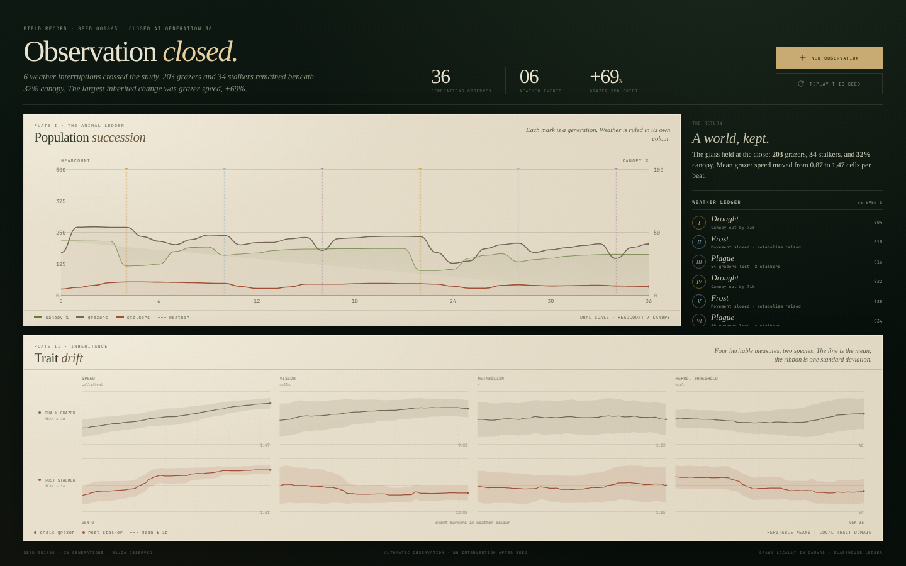](https://commandcodeai.github.io/benchmark-deepseek-v4.1-flash-rematch/runs/opencode-2.1.4/output/index.html) |

#### Pi 1.4.0: "The Vivarium Ledger"

| Live simulation | End-of-run dashboard |
|---|---|
| [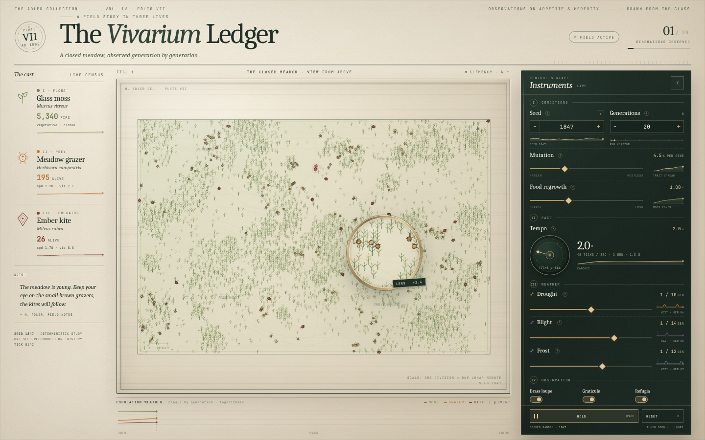](https://commandcodeai.github.io/benchmark-deepseek-v4.1-flash-rematch/runs/pi-1.4.0/output/index.html) | [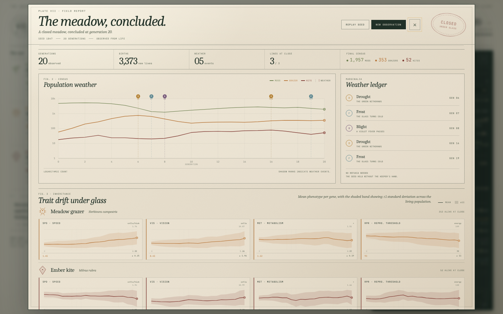](https://commandcodeai.github.io/benchmark-deepseek-v4.1-flash-rematch/runs/pi-1.4.0/output/index.html) |

**▶ Play them live:** [The Nocturne Vivarium](https://commandcodeai.github.io/benchmark-deepseek-v4.1-flash-rematch/runs/deepseek-v4.1-flash/output/index.html) · [Succession in vitro](https://commandcodeai.github.io/benchmark-deepseek-v4.1-flash-rematch/runs/deepseek-v4.1-flash-fast/output/index.html) · [all games on one page](https://commandcodeai.github.io/benchmark-deepseek-v4.1-flash-rematch/)

Or clone the repo and open [`runs/deepseek-v4.1-flash/output/index.html`](./runs/deepseek-v4.1-flash/output/index.html)
or [`runs/deepseek-v4.1-flash-fast/output/index.html`](./runs/deepseek-v4.1-flash-fast/output/index.html)
in a browser (on github.com those two links show the source). No server, no network needed.

## What this shows

Over 249 model requests across two runs, the Command Code service returned
**zero** failed calls, zero timeouts and zero transport errors on this exact
prompt. Average TTFT was 7.08s and 3.51s, against the 48.12s the post reports,
and P95 TTFT was 13.65s and 6.06s, against 154.47s.

The post's run differs from ours in three ways its logs make visible: image
input on, 92 screenshots resent on every request, and 3 concurrent agents. A ~90-image,
3-agent workload like that should be handled by the harness in the first place.
Without screenshots in context his run had no failures. We're improving the API
anyway so it streams heavy image payloads upstream instead of failing.
Details and every number: [`naz-session/`](./naz-session/).

## Setup

- CLI: `command-code@1.88.0` from npm, authenticated with a Command Code API key
  (normal Command Code backend, no BYOK, no local-only mode).
- Models: `deepseek/deepseek-v4.1-flash` and `deepseek/deepseek-v4.1-flash-fast`.
- Command (see each `runs/*/run.sh`):

  ```
  cmd -p "<prompt>" -m deepseek/<model> --effort max --output-format json \
    --yolo --trust --skip-onboarding --no-auto-update --max-turns 400
  ```

- Each run started in an empty git repo. Both runs ran at the same time on the
  same machine, 2026-10-25, starting 21:28 UTC.
- `-p` is headless mode, so the default headless tool set applied (`--tools-all`
  was not passed). `--max-turns 400` only lifts the default cap of 100, neither
  run came near it.

## How each number is computed

[`scripts/ts.mjs`](./scripts/ts.mjs) reads the CLI's NDJSON stdout and stamps each
line with its arrival time. It never talks to the model or the harness.
[`scripts/analyze.mjs`](./scripts/analyze.mjs) turns that log into `metrics.json`:

- **Total time**: wall clock from launch to exit (`start`, `end`).
- **TTFT**: `model_request_start` → first streamed delta of that request.
- **Throughput**: total output tokens ÷ total streaming time (first delta →
  `model_request_end`), summed over requests.
- **Cache hit**: `cacheReadTokens ÷ inputTokens`. Uncached input is
  `inputTokens − cacheReadTokens − cacheWriteTokens`.
- **Failed API calls**: a `model_request_start` with no matching
  `model_request_end`, plus any error, retry or failure event that is not a tool
  event. Both runs: 0.
- **Tool errors** are counted separately because they are the model's own
  mistakes, not provider failures (for example `edit_file` refused because the
  file changed since it was last read). The run continues after each one.

Reproduce:

```
cd runs/deepseek-v4.1-flash-fast
gunzip -k events.ndjson.gz && sha256sum -c events.ndjson.sha256
node ../../scripts/analyze.mjs .   # matches metrics.json byte for byte
```

### Provider API runs

Every other harness talked to Command Code through its own copy of
[`scripts/proxy.mjs`](./scripts/proxy.mjs), a local pass-through proxy that
forwards each request unchanged and records, per request, its timings, status,
usage and any error (`proxy/calls.ndjson.gz`), plus the full request and
response bodies. [`scripts/analyze-proxy.mjs`](./scripts/analyze-proxy.mjs)
computes `metrics.json` with the same definitions as above:

- **TTFT**: request start → first SSE chunk with content, reasoning or a tool call.
- **Throughput**: output tokens ÷ (end − first chunk), summed over requests.
- **Cache hit**: cached prompt tokens ÷ prompt tokens.
- **Failed calls**: transport errors, HTTP 4xx/5xx, and HTTP 200 streams that
  stopped before the usage block (cut off mid-generation). A client closing the
  socket after the final chunk is not a failure.

The Command Code harness rows are measured from the CLI's own event stream and
the Provider API rows at the proxy, so the measuring point differs slightly; the
definitions are the same.

Reproduce a Provider API run:

```
cd runs/dsh-0.2.1-rc.3
mkdir -p /tmp/r/proxy && cp start end exit /tmp/r/
gunzip -c proxy/calls.ndjson.gz > /tmp/r/proxy/calls.ndjson
(cd /tmp/r/proxy && sha256sum -c $OLDPWD/proxy/calls.ndjson.sha256)
node ../../scripts/analyze-proxy.mjs /tmp/r   # matches metrics.json
```

## Notes we are not hiding

- Flash Fast had one slow request: 6m 24s at 28 tok/s for 10,751 tokens
  (its first token arrived quickly; the stream itself was slow). The four
  requests before it ran at 179–270 tok/s. It is included in every number above.
- Flash Fast took longer overall than plain Flash because it did more work
  (138 vs 111 requests, 436K vs 325K output tokens), not because of failures.
- This is a different setup from the post: Command Code's own CLI rather than
  the DSH harness, and V4.1 Flash rather than whatever "GOAT" routed to there.
  It shows what the Command Code stack does on this task today. It does not
  replay the post's run.
- One run per model and harness. Repeat runs would tighten the numbers.
- Harness setup for the Provider API runs, all on the same machine, in
  parallel, on 2026-10-26: DSH (`@deepseek-ai/dsh` 0.2.1-rc.2 and 0.2.1-rc.3,
  headless profile, Command Code added as an OpenAI-compatible route with the
  same 1M context / 256K output limits DSH uses for its own DeepSeek Flash,
  `thinking` enabled plus `reasoning_effort: max`, telemetry disabled; see
  `command-code.patch.yml`), OpenCode (`opencode-ai` 1.19.4 and `@opencode/cli`
  2.1.4, `@ai-sdk/openai-compatible`, `reasoningEffort: max`, auto-approve; see
  `opencode.json`), Pi (`@earendil-works/pi-coding-agent` 1.4.0,
  `--thinking max`, `thinkingFormat: deepseek`; see `models.json`).
- OpenCode and Pi hung at startup with stdin left open, so stdin was closed for
  every run. Pi ran with `--offline`, which only skips its startup model-catalog
  refresh. OpenCode could not reach models.dev from the machine, which only
  affects its built-in catalog; the model was defined by hand.
- Pi was configured with image input enabled and no image resize profile, which
  made its requests larger than they would be with a resize profile.
- OpenCode 1.19.4 ran with the machine's home directory, so a few skill
  descriptions from that home directory ended up in its system prompt.
- The first OpenCode 2.1.4 attempt crashed in 20 seconds without making a
  request: a background service left over from our smoke test held its port.
  It is kept in `setup/opencode-2.1.4-attempt1-port-conflict/`; the run in
  `runs/opencode-2.1.4/` is the clean restart.
- Machine-specific details were normalized before publishing, and nothing else
  was changed: local paths are rewritten (the working directory reads `/work`),
  and machine-specific names (installed tools, home-directory files, host
  directory names) read `[redacted]`, including where a model, a harness log or
  a session echoed them. This applies inside every compressed log, session file
  and database too. Token counts and timestamps are untouched, and the metrics
  reproduce exactly from the published logs.
- The DeepSeek Harness columns (Naz's runs) are copied from his Round 1 image,
  not measured here. His CommandCode GOAT session files are in `naz-session/`,
  copied unchanged from his own repo.
- Left out of the Provider API runs: installed npm packages, the empty `.git`
  of each working dir, and OpenCode 2's local-service password file. The full
  list is in [`setup/EXCLUDED.md`](./setup/EXCLUDED.md).

## What is in this repo

Nothing from the runs was thrown away.

```
round1-*.png                results cards (scripts/card.mjs + layouts/*.json)
original-post-claim.webp    the image from the post being answered
prompt.txt                  the exact prompt
scripts/                    ts.mjs, analyze.mjs, card.mjs, shot.cjs, proxy.mjs,
                            analyze-proxy.mjs, status.mjs, sheet.cjs
scripts/reported/           Naz's three DeepSeek Harness runs, copied from his image
naz-session/                Naz's own CommandCode GOAT session files (as he published
                            them) and our analysis, with scripts/analyze.py
layouts/                    which columns go in each card
runs/<model>/
  run.sh                    exact launch script
  start, end, exit          epoch ms timestamps and exit code
  stderr.txt                CLI stderr
  events.ndjson.gz          full timestamped NDJSON event stream (gzipped, lossless)
  events.ndjson.sha256      checksum of the uncompressed stream
  metrics.json              computed metrics
  session/                  Command Code session: transcript (.jsonl),
                            checkpoints (.checkpoints.jsonl), metadata (.meta.json)
  output/                   everything the model wrote in its working dir,
                            final index.html plus every intermediate file
  tmp-files/                files the model wrote to /tmp (test scripts,
                            its own screenshots), attributed via its transcript
  screenshots/              our headless checks at 3s, 30s and 120s
runs/<harness-version>/     Provider API runs (DSH, OpenCode, Pi)
  run.sh, start, end, exit  launch script, epoch ms timestamps, exit code
  stderr.txt, proxy.log     harness stderr and proxy log
  events.ndjson.gz/.sha256  the harness's own JSON event stream, timestamped
  proxy/calls.ndjson.gz     one line per model request: timings, status, usage, errors
  proxy/bodies/*.res.gz     every response body, as streamed
  proxy/requests.tar.zst    every request body (tar, zstd long-range: `zstd -d --long=27`)
  metrics.json              computed metrics
  session/                  the harness's own session files and state
                            (DSH home/, OpenCode xdg/, Pi agent/)
  command-code.patch.yml    DSH provider config  | opencode.json | models.json (Pi)
  output/                   everything the model wrote, final index.html included
  screenshots/              our headless checks at 3s, 30s and 120s
setup/                      smoke tests for each harness, the failed first
                            OpenCode 2 attempt, and EXCLUDED.md
unattributed-tmp/           /tmp files from the run window whose names are built
                            dynamically, so neither transcript names them
                            (one, check-page.js, is named by both)
probe/                      the one-word "say hi" probe run first to check the
                            output format, plus a mid-run preview of the card
```

The empty `.git` that `git init` created in each working dir is the only thing
left out: it held no commits, and a nested `.git` cannot be committed.
